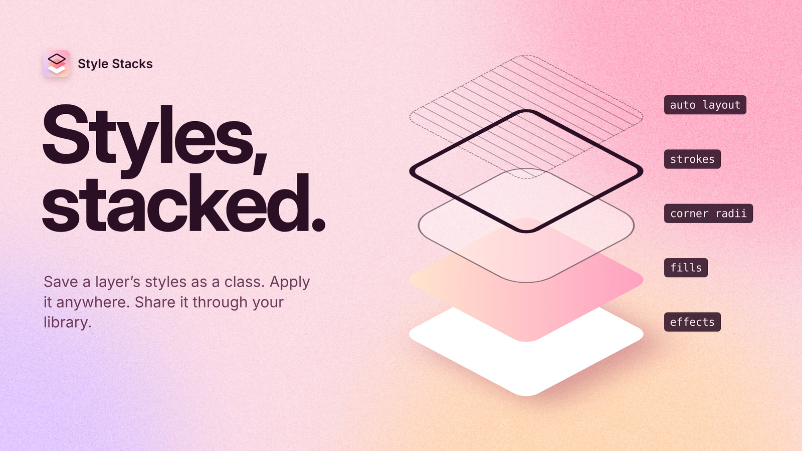
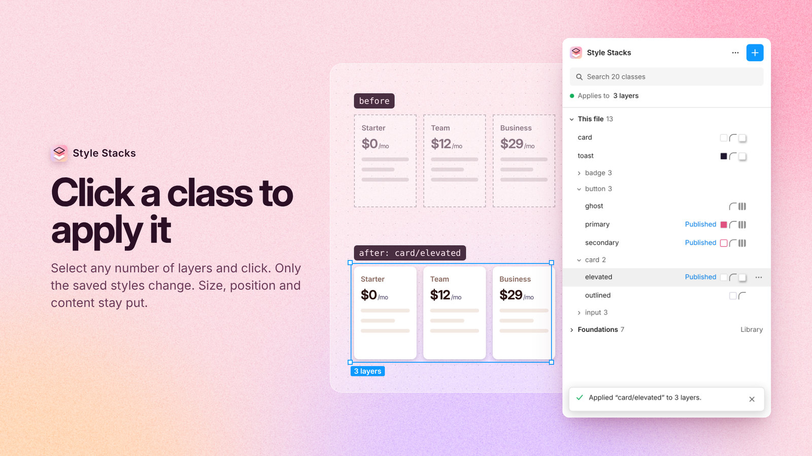
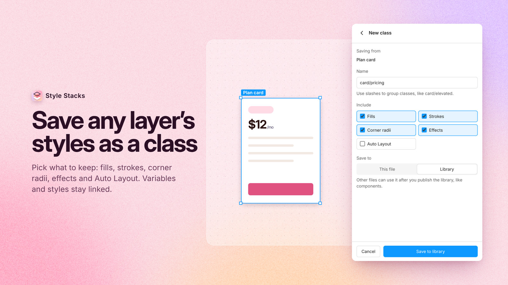
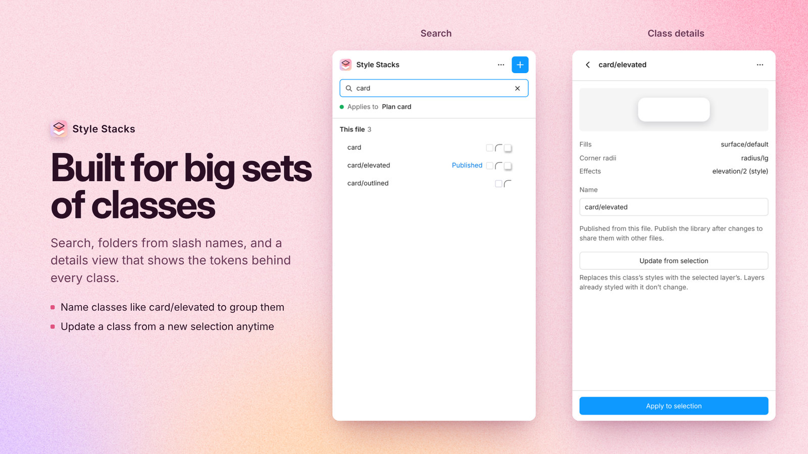
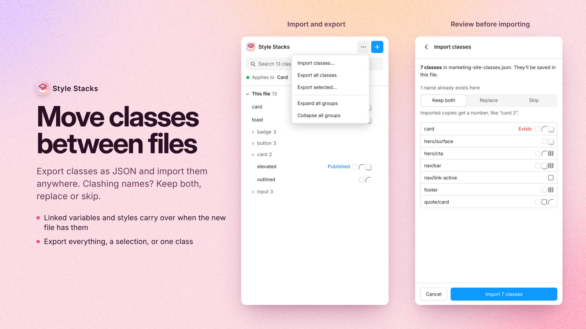
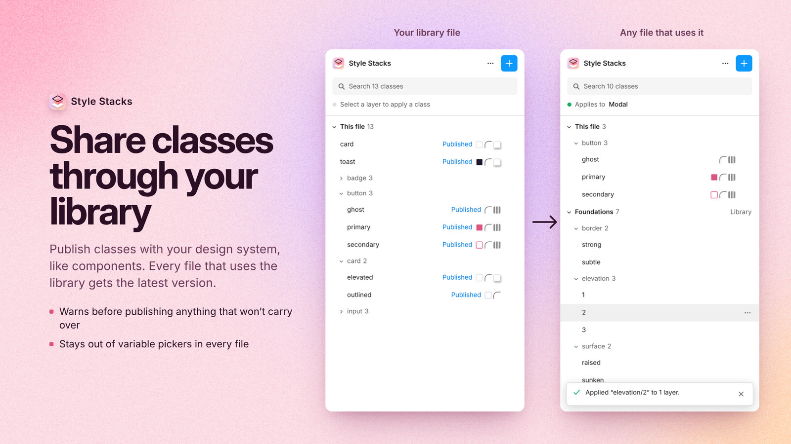

# Style Stacks

Save a layer's fills, strokes, corners, effects and Auto Layout as a class. Apply it anywhere.

Style Stacks is a Figma plugin that saves the styling of a layer as a reusable *class*. Apply it to any other layer with one click, without touching its size, position or content. Think of it as a named clipboard for styles, one your whole team can share through a library.

Classes are recipes, not live links: updating a class doesn't change layers you styled with it earlier.

**Figma Community:** in review. Link coming once it's approved.

## Quick start

**Save a class**
1. Select a layer that has the styling you want to reuse.
2. Open Style Stacks and click **+**.
3. Name the class. Use slashes to group it, like `button/primary`.
4. Choose what to include, then click **Save class**.

**Apply a class**
1. Select one or more layers.
2. Click a class in the list.

| Apply | Save |
|---|---|
|  |  |

## Features

- **Find** classes fast: search, plus collapsible groups by source (this file, then each library) and by slash folder (`card/elevated` sits in a `card` folder). Small icons on each row show what a class contains.
- **Save** a class from the selected layer with **+**, choosing which property groups to include:
  - Fills
  - Strokes (weight, alignment, dash)
  - Corner radii
  - Effects
  - Auto Layout (direction, padding, spacing, alignment)
- **Apply** a class to one or many selected layers with one click. Only the saved groups are applied; everything else is preserved.
- **Manage** classes from the details view (**⋯** on a row): preview, contents with token names, rename, update from the current selection, add to library, export, delete.
- **Import and export** classes as JSON from the header **⋯** menu: export all, export selected, or one class from its details. Import shows which names already exist and lets you keep both, replace or skip. Variables and styles are matched to the new file by key; anything it doesn't have falls back to plain values.
- Preserves **variable bindings** and **native styles** where the Plugin API allows, with saved literal values as a fallback.
- Classes are stored in the Figma document (plugin data), so they persist when the file is reopened. No accounts, no network access, no dependencies at runtime.

| Search and details | Import and export |
|---|---|
|  |  |

## Library classes

Design system teams can share classes through a Figma library, the same way they share components.



1. **Save to library.** In the library file, choose **Save to: Library** when saving a class, or use **Add to library** in an existing class's details menu. Then publish the library.
2. **Pick and apply.** In any file that uses the library, its classes appear in their own group, named after the library. Applying one always uses the latest published version, with no library update to accept.
3. **Portability warning.** Before a class goes into the library, Style Stacks warns about anything that won't work in other files: variables or styles that are hidden or not yet published, raw values that match a token but aren't linked to it, and image or pattern fills.

Library classes can only be edited in their library file.

Under the hood, each library class is a string variable in a **Style Stacks** variable collection in the library file. Its value is the class recipe as JSON, its scopes are empty so it stays out of property pickers, and its description is `style-stacks:class v2` so sync tooling can skip it. Consumer files find classes with the team library API and resolve tokens and styles by published key.

## Development

From the repo root, run `npm install`, then:

```sh
npm run build -w style-stacks       # build ui.html and compile code.ts -> code.js
npm run watch -w style-stacks       # rebuild on change
npm run typecheck -w style-stacks
```

To load the plugin in Figma: **Plugins → Development → Import plugin from manifest…** and select `plugins/style-stacks/manifest.json`.

## Project layout

| File | Purpose |
|---|---|
| `code.ts` | Plugin logic: serialization, document and library storage, portability checks, capture, application |
| `src/ui.html`, `src/ui.css`, `src/ui.js` | Plugin UI source, built into the generated `ui.html` |
| `manifest.json` | Figma plugin manifest |
| `assets/` | Icon (SVG and PNG) used in the plugin UI |
| `../../docs/img/` | Community listing cover, slides and icon; `readme/` holds smaller copies for this README |
| `product-brief.md` | Original brief and implementation notes |

## Limitations

- Auto Layout is captured only from non-grid frames, and skipped on hug-sized targets to preserve their sizing.
- Mixed text fills, shader/video paints, and shader effects are not captured.
- Locked layers and layers inside instances are skipped.
- Layers styled with a library class don't update when the class changes. Token-bound properties still follow token changes.
- The **Style Stacks** collection shows up in consumer files' library list and Variables panel.

## License

[MIT](../../LICENSE)
